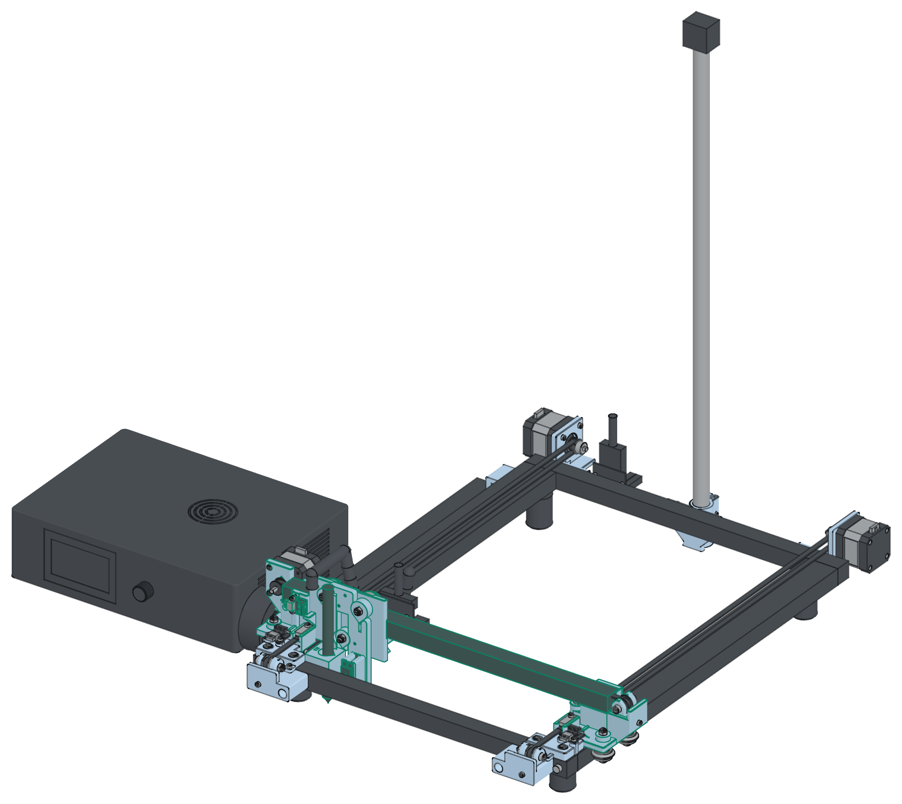

# Pen plotter

<picture>
  <source media="(prefers-color-scheme: dark)" srcset="hardware/docs/hero-dark.png">
  
</picture>

A table pen plotter from a dismantled Creality CR-10 V3. The CR-10 base frame stands on the table,
and the table is the bed. Stock V-wheels carry both axes, two Y motors square the gantry, and a
servo lifts the pen. The stock CR-10 V3 control box drives the plotter. Its ATmega2560 runs the
firmware, which is written in Go and built with TinyGo. Plotstudio scans the bed with a camera,
places SVG drawings and signatures on the paper, and plots them in up to 16 pen colours over USB.

- Travel 245 × 390 mm. A4 and Letter fit.
- The stock control box, its drivers, its LCD with the knob, and its harness stay. The two
  Creality breakout boards stand bare on nylon standoffs, held by cable ties.
- 22 printed parts in PLA (16 print jobs): 23 h 08 min, 406 g, $8.12. No supports. This includes
  the optional camera pole foot. The camera is a USB webcam on your own 590 mm pole.
- Purchased parts: about $181 (belts, toothed idlers, screws, T-nuts, heat-set inserts, a drag
  chain, a servo and a few cables). The belt jaws are printed. The total with the printed parts is
  about $189. The 9 stock V-wheels, the motors and the pulleys are reused. A printed X
  plate replaces the stock X carriage plate.
- USB serial at 115200 baud. Top speed 120 mm/s.
- You change the pens by hand.

The design is complete and checked in software. It is not built yet.

## Requirements

- Go 1.26 or later (`go.mod` sets `go 1.26.0`).
- TinyGo 0.44 for the firmware.
- An internet connection for the 3D window of the simulator. The page loads three.js 0.170.0
  from the jsDelivr CDN.
- For the hardware build: uv, Node.js, Chromium, ImageMagick and CuraEngine.

## Quick start

Run the simulator. It runs the same firmware code as the stock board, with a 3D window and an LCD
window:

```sh
go run ./sim/cmd/plotsim -gcode samples/test-drawing.gcode
```

Run plotstudio against the simulator. The TCP port stands in for the USB serial port:

```sh
go run ./sim/cmd/plotsim -no-open &
go run ./studio/cmd/plotstudio -port tcp://127.0.0.1:2323 -camera http://127.0.0.1:8765/camera.jpg
```

Flash the firmware to the stock control box over USB:

```sh
tinygo flash -target=arduino-mega2560 -port /dev/ttyUSB0 ./firmware/cmd/mega
```

Then plot with the real plotter:

```sh
go run ./studio/cmd/plotstudio -port /dev/ttyUSB0 -camera /dev/video0
```

Build the printed parts, the checks and the hardware PDF (needs uv, Node.js, Chromium,
ImageMagick and CuraEngine):

```sh
hardware/make.sh
```

Build the full guide:

```sh
go run ./tools/guide
```

Run the tests:

```sh
go vet ./... && go test -race ./...
```

The repository also has a full controller for a Pico W board (`firmware/cmd/pico`), with Wi-Fi
and the network API. This build does not use it. `firmware/README.md` describes it.

## Documents

- `docs/penplotter-guide.pdf`: the full guide in one PDF. The chapters are in `docs/guide/`.
- `hardware/penplotter-build-guide.pdf`: the step-by-step hardware build, with the print list.
- `docs/bom.md`: the parts to buy, with approximate prices.
- `docs/wiring.md`: the stock pin map and the wiring.
- `docs/network-api.md`: the network API of the Pico W firmware. This build does not use it.
- `docs/studio.md`: plotstudio.
- `docs/printdeck.md`: the Printdeck integration. It needs the Pico W firmware.
- `hardware/REVIEW.md`, `firmware/REVIEW.md`, `studio/REVIEW.md`, `docs/REVIEW-integration.md`: the review rounds.

## Credits

- The hole positions of the CR-10 carriage plate come from the model `carriage_plate_Bear.step` by
  Bear (https://www.printables.com/model/205016), under CC BY. A second model by J_Cross
  (https://www.printables.com/model/139901, CC BY) agrees with it to about 1 mm.
  `hardware/reference/SOURCES.md` lists the reference models.
- The text in the sample `blueprint.py` uses the Hershey fonts. Dr.
  A. V. Hershey digitized these fonts at the U.S. National Bureau of Standards. The font data is
  in the public domain. The sample reads it with the Hershey-Fonts Python package by Attila
  Kolinger (https://github.com/apshu/HersheyFonts, MIT License).

## License

Code MIT, designs and documents CC BY 4.0. `profiles/` is a copy of the Printdeck profiles and
keeps the AGPL-3.0 of Printdeck. See [LICENSE.md](LICENSE.md).

Creality, CR-10 and LulzBot are trademarks of their owners. This
project is not affiliated with them.
