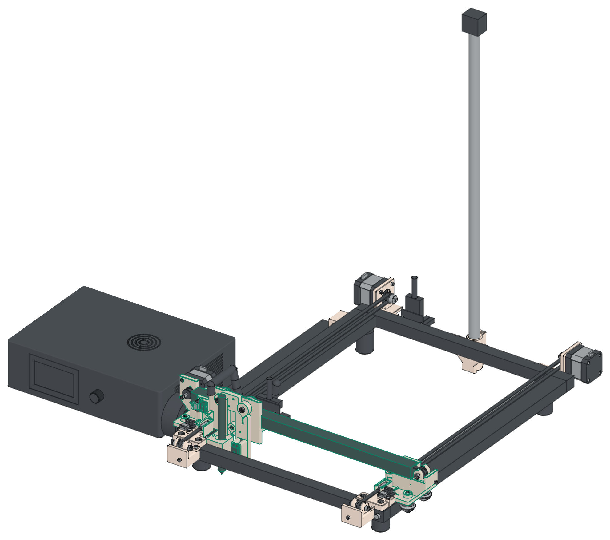

# Hardware

The plotter is the base frame of a Creality CR-10 V3 on a table. The table is the bed. Stock V-wheels carry both axes. The motors do not move. Printed parts join the CR-10 parts. No metal part is cut or drilled.

The printed parts copy the stock CR-10 layouts, but they keep only the features that the plotter uses. No stock carriage plate stays on the machine.

The design files are in `hardware/`. `hardware/make.sh` builds the parts, checks them, slices them, and writes `hardware/penplotter-build-guide.pdf`. `hardware/REVIEW.md` records the review rounds.

## The machine

- **Frame.** The CR-10 base frame. The front and back cross bars are 2020 and run the full width of the frame. The two long 2040 frame rails lie flat between them. Outside 400 × 520 mm, inside 320 × 480 mm. The frame rail tops are 57 mm over the table.
- **Feet.** Your own 4 round rubber feet stay under the long rails, 37.5 mm from each end of the frame. The model uses 28 mm across and 37 mm high (ESTIMATE). Nothing of a carriage goes under the rail, so the feet do not limit the travel.
- **Y carriages.** Each Y carriage is one flat 6 mm printed plate, in the form of the stock CR-10 Z carriage plate. It prints flat. It runs on 3 stock V-wheels on vertical axles in the side slots of the rail. Two wheels run in the outer slot, 44 mm apart. The back outer wheel turns on an eccentric spacer, which sets the preload. The front outer wheel axle goes into a long M5 heat-set insert. One wheel runs in the inner slot, 18 mm behind the beam centre, under a 12 mm boss. The plate also has two clamp blocks for the Y belt and a striker fin for the Y endstop. It carries no motor.
- **Y drive.** The two Y motors (42-40) are fixed. Each one stands behind the back bar on a printed bracket (`y_motor_mount_*`), about 20 mm outside the frame line, as on the stock CR-10. Two M5 × 12 screws in T-nuts hold each bracket in the back face slot of the bar. A toothed 20T idler turns in a fork (`y_idler_fork`) in front of the front bar. The fork sits in a bracket (`y_idler_bracket_*`) under the two lips of the front base. An M3 tension screw from the front pulls the fork forward.
- **Y belt.** Each Y belt is a loop round the motor pulley and the idler. It lies flat over the inner top slot of the 2040 rail, 31.5 mm from the outer face of the side. The belt does not go into the slot: the 2020 bars close the slot ends. The carriage clamps the upper run in two clamp blocks, with a crimp clip in each pocket. The Y motor cables do not move.
- **X axis.** The CR-10 2020 X beam lies on a saddle at each Y carriage. One M5 × 12 screw goes through the short back wall of the saddle into a T-nut in the back slot of the beam, 14 mm from the beam end. A stop at the outer end of each saddle holds the beam along X. The inner face of the saddle is the hard stop of the X plate.
- **X drive.** The X belt follows the stock CR-10 belt path. The pulley axis lies along Y, on the beam centre line, past the left beam end. The X motor (a 42-34) stands behind it, on the motor wall of the left carriage. The belt lies flat: one run in the channel of the top slot, one in the channel of the bottom slot, under the V-wheel tips. A toothed 20T idler turns in a fork (`x_idler_fork`) past the right beam end. An M3 × 20 screw with a nut pulls the fork outward from outside the right carriage. No belt stands in front of the beam.
- **X carriage.** Two printed parts: the X plate (`x_carriage_plate`) and the pen carriage. Four M3 × 12 screws join them. The X plate replaces the stock Creality plate. It takes the 3 stock V-wheels. The eccentric spacer is on the top right wheel: its hex is reachable from above. The other two wheels use stock 6 mm spacers. The bottom wheel axle goes into a long M5 heat-set insert. At each end of the plate, the bottom belt run leaves the slot at 45 degrees into a crimp clip pocket under the beam. The plate also has the X endstop trigger lug at the bottom left and the tie slot of the servo loom at the top left.
- **Pen carriage.** One part on the front of the X plate, held by the 4 M3 × 12 tool head screws from the back of the plate (T1, T2, H1, H2). A servo lifts the pen slider on a dovetail rail. The slider holds the pen in a V bore with an M3 clamp screw. The weight of the slider and the pen is the pen force.
- **Moving cables.** One openable drag chain (inner 10 × 20 mm, R28, about 506 mm) lies beside the left rail, outside the frame. It carries only the head harness. A 10 × 15 chain is enough. Its lower run lies on the table. Its fixed end sits in `y_chain_anchor` at the back left corner. Its moving end bolts to a tab of the left carriage plate. The servo lead runs in a 1/2 inch split wire loom, in a free loop behind the beam. A cable tie at each end holds the loom: through the slot at the top left of the X plate, and round the head harness cable above the big plug. The X motor plugs into the head board on the beam, so its cable does not move.
- **Static wires.** The Y endstop wires run in the bottom outer slots of the rails and in the bottom slot of the back bar, under flexible 6 mm slot cover strips. The Y motor cables run on the table behind the frame to the base board. These wires do not move (`hardware/context_detail_HOOKUP.md`).
- **Endstops.** The stock Creality endstop boards (20 × 20 mm, KW12 switch, XH plug). Each Y board lies on the two standoffs of a front base. A striker fin on the front edge of the carriage plate meets the lever tip. The X board sits on the front of the X endstop wall of the left Y carriage, in front of the beam end. The trigger lug at the bottom left of the X plate meets its lever. At each hard stop the trigger is 1.5 mm past the click. There are no switches at the far ends: the firmware uses soft limits there.
- **Controller.** The stock CR-10 V3 control box stands on the table beside the frame. The stock harness stays. The head board stands bare on the back face of the X beam, at x = 96 mm. The base board stands bare on the back face of the back bar, at x = 71 mm. Each board stands on two 4 mm nylon standoffs, held by two cable ties. The big plug points up.
- **Camera pole (optional).** The camera is a USB webcam on the top end of your 590 mm pole (17.85 mm diameter). The printed pole foot (`mast_foot`) holds the pole behind the centre of the back bar. An M6 × 16 screw goes up through its floor into the pole end. A split collar with one M3 screw takes up the play. Two M5 × 12 screws in T-nuts hold the foot on the back bar.

| Value | |
|---|---|
| Pen travel | 245.9 × 395.1 mm in the model. The firmware uses 245 × 390 mm. |
| Travel stops | Y min: the carriage plate at the front base. Y max: the inner Y wheel at the back bar. |
| Home | The front left corner. Homing squares the gantry on the two Y switches. |
| Belts | GT2 6 mm. Y: 1135.0 mm between the folds. X: 898.3 mm. |
| Pulleys and idlers | GT2 20T pulleys and GT2 20T toothed idlers: 80 steps/mm on X and Y |
| Motors | X: 42-34 (213.4 g, measured). Y1 and Y2: 42-40 (286.7 g, measured). One 42-40 and one 42-34 stay as spares. |
| Pen lift | 7.0 mm |
| Pens | Round barrels 8 to 15 mm in the V bore of the pen slider |

The gantry is about 630 g lighter than with the motors on the carriages. The 42-34 X motor is 73.3 g lighter than a 42-40.

## Printed parts

All parts print in PLA, 0.3 mm layers, on a LulzBot TAZ Workhorse with the SE tool head (0.5 mm nozzle). No part needs supports.

| Part | Count | Notes |
|---|---|---|
| `y_carriage_left`, `y_carriage_right` | 1 each | Flat, the plate on the bed. A 6 mm plate on 3 side wheels with the Y belt clamps, the beam saddle and the Y endstop striker. The left one has the chain tab, the X motor wall and the X endstop wall. The right one has the seat of the X idler fork. |
| `x_carriage_plate` | 1 | Upright, the bottom edge on the bed. 3 wheel bosses, the 2 X belt clamps under the beam, the X endstop trigger lug, the tie slot of the servo loom. |
| `y_motor_mount_left`, `y_motor_mount_right` | 1 each | On the motor face. Holds a Y motor behind the back bar. |
| `y_front_left`, `y_front_right` | 1 each | Bottom on the bed. The Y endstop board, and the lips over the front of the bar. |
| `y_idler_bracket_left`, `y_idler_bracket_right` | 1 each | On the end wall. The seat and the end wall of a Y idler fork, in front of the front bar. |
| `y_idler_fork` | 2 | Floor on the bed. Holds a Y idler between two cheeks. |
| `x_idler_fork` | 1 | Floor on the bed. Holds the X idler past the right beam end. |
| `y_chain_anchor` | 1 | On its front face. The fixed end of the drag chain at the back left corner. |
| `pen_carriage` | 1 | Back face on the bed. The pen lift. It bolts to the front of the X plate. |
| `pen_slider` | 1 | Upright. Holds the pen in its V bore with an M3 clamp screw. It slides on the dovetail rail of the pen carriage. |
| `mast_foot` | 1 | Optional. The camera pole foot. Floor on the bed. |
| `fit_rail`, `fit_slider`, `fit_wheel` | 1 each | Print first. The first two test the dovetail fit. `fit_wheel` tests the eccentric hole of an outer Y wheel and the hole of the inner wheel. |

The build prints 16 parts in 15 print jobs: 21 h 45 min, 383 g, $7.66. `05-parts-and-cost` has the values for each part and the fastener list.

## Heat-set inserts

The build uses 9 heat-set inserts. You need a soldering iron with insert tips (BOM M35).

| Insert | Count | Where |
|---|---|---|
| M5, long (9.5 mm) | 3 | The front outer wheel axle of each Y carriage, and the bottom wheel boss of the X plate |
| M3 (5.7 mm) | 6 | The two Y endstop boards (two in each front base) and the X endstop board (two on the X endstop wall of the left Y carriage) |

## The review

The design went through many review rounds. `75-review-history` lists them, and `hardware/REVIEW.md` has the details. The last change (2026-11-10) simplifies the build:

1. **Fewer parts, manual pen changes.** The build drops 11 printed parts that the plotter does not need (`75-review-history` lists them). You change the pens by hand.
2. **Flat Y plates.** Each Y carriage is a flat 6 mm plate on the stock wheel layout. A saddle holds the beam at its old height. The home and the travel do not change.
3. **The X endstop in front of the beam end.** The board faces the front. A lug at the bottom left of the X plate presses its lever.
4. **Bare boards.** The two breakout boards stand on nylon standoffs, held by cable ties.
5. **The servo loom.** The servo lead runs in a 1/2 inch split wire loom, with a cable tie at each end.
6. **A 42-34 X motor.** The X motor rides on the gantry, so the shorter motor keeps the moving mass low.

| | Before | Now |
|---|---|---|
| Printed parts (main build, no fit tests) | 27 parts, 30 h 28 min, 544 g | 16 parts, 21 h 45 min, 383 g |
| Heat-set inserts | 13 | 9 |
| Pen travel (model) | 245.9 × 395.1 mm | 245.9 × 395.1 mm |
| Pen changes | Automatic (6 bins) or by hand | By hand |

The joint audit passes with `--gate`. Six notes stay outside the gate, all on the Y motor brackets. They are tool and torque notes, not strength faults:

- Fit the motor screw that the bar hides before each Y bracket goes on the bar.
- The M3 heads of the right Y motor bracket bear on PLA. Put an M3 washer under each head, or tighten by feel. The left bracket has the same joint.

One question is open. The two cable ties of the head board go round the beam, through the top and the bottom slots and over the front face. The X plate and its wheels pass that place. `hardware/REVIEW.md` lists the options. Check this before you tie the head board on.

## Measure before you print

`hardware/MEASURE.md` lists all measurements. These are the most important ones:

- The feet (items 1 to 3): their height (37 mm in the design) and their place. The height moves all the other parts.
- **Item 59: the V-wheel tip in its slot.** The X belt runs under the wheel tips. The fit check needs 0.3 mm or more between the tip and the belt. If the gap is less than 0.3 mm, use a GT2 16T pulley and a 16T toothed idler. The runs then lie 1.3 mm deeper, and the firmware needs 100 steps/mm.
- **Item 60: the slot channel of the beam.** The opening, the channel width, the lip depth and the depth to the core (6.2, 11.0, 1.8 and 6.3 mm in the model, ESTIMATE).
- **Item 61: the X belt on the stock machine.** Before you take the CR-10 apart: does the X belt touch the wheel tips or the slot lips? Is the stock X idler a 20T toothed idler?
- **Item 62: the plain wheel spacers.** Count the plain 6 mm spacers on the stock X plate, the Z carriages and the bed carriage. The build needs 6.
- Item 43: a GT2 20T toothed idler: the flange diameter and the width (18 and 8.5 mm in the design).
- Items 46 and 47: the head harness and the drag chain. The harness must pass through the openable chain.
- Items 24 to 33: the head board and the base board: their size and the hole spacing. The model uses estimates from photos.
- Items 63 to 65: the X endstop overtravel, the head harness cable at the loom tie, and the body length of the 42-34 motor.
