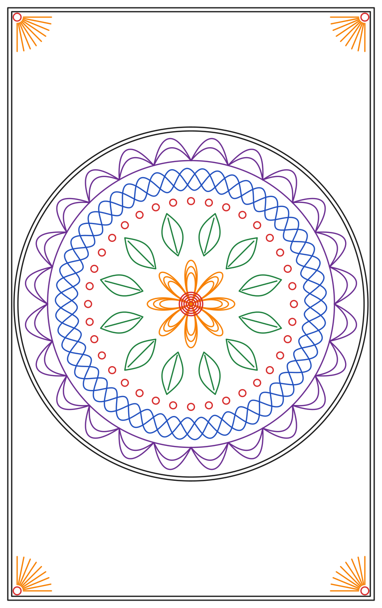

# Software

This chapter sets up the software that you use each day: plotstudio on a computer, the USB link
to the plotter, the camera, the pens, and the simulator. `25-firmware` has the flash of the
control box and the G-code list. The plotter connects over USB only.

## The parts

| Part | Where it runs | What it does |
|---|---|---|
| Firmware | The ATmega2560 in the control box | Plans the moves, drives the motors and the servo, shows the LCD. Written in Go, built with TinyGo. |
| plotstudio | A computer with the camera (Linux) | Scans the bed, places drawings, plots them over USB. |
| plotsim | A computer | Runs the same firmware code with a 3D window and a simulated camera. No hardware needed. |

Plotstudio, plotsim and the firmware are pure Go. They need no Python, no OpenCV and no cgo.

## Install plotstudio

1. Install Go 1.26 or later.
2. Get the repository, and build plotstudio:

   ```sh
   cd penplotter
   go build -o plotstudio ./studio/cmd/plotstudio
   ```

3. Start it. Give the plotter and the camera:

   ```sh
   ./plotstudio -port /dev/ttyUSB0 -camera /dev/video0
   ```

4. Open http://127.0.0.1:8780 in a browser. A phone works too: start plotstudio with
   `-addr 0.0.0.0:8780` and open the address of the computer.

Plotstudio keeps its files in `~/.config/plotstudio/`: the calibration of each camera, the pen
table, and the signature library.

## Connect the plotter

### USB

1. Connect the USB port of the control box to the computer.
2. Type `/dev/ttyUSB0` in the **Plotter** card, or push **Find**. Push **Connect**.

The control box shows up as `/dev/ttyUSB0`. With no `-port`, plotstudio uses the first
`/dev/ttyUSB*` device, then the first `/dev/ttyACM*` device. Plotstudio opens the port at
115200 baud.

A lost link does not stop plotstudio. It connects to the same plotter again every 3 s. A job that
ran on a lost link stops; plot it again.

## Set up the camera

1. Put the USB webcam on the top of the camera pole, behind the centre of the back bar
   (`15-assembly`). The lens is about 616 mm above the table. Point it down and a little forward.
2. Run `./plotstudio -list-cameras`, and start plotstudio with the camera: `-camera /dev/video0`.
3. Open the **Camera** tab and push **Live view**. The picture must show the whole frame opening.
4. Push **Focus → Lock** when the picture is sharp. A change of focus after the calibration
   moves the picture.

## Calibrate the camera

Do this once for each camera position.

1. Tape a sheet of paper over the whole travel.
2. In **Calibrate**, select **3 × 3 points** (or 4 × 4 for the best result).
3. Push **1. Draw marks**. The plotter homes and draws 9 small dots.
4. Push **2. Click marks**. Click each dot in the order of the hint. The click snaps to the
   centre of the dot.
5. Push **Solve**. An error below 0.3 mm is good. The chip shows **Calibrated ±0.xx mm**.

Each camera has its own calibration file. A move of the camera or the pole needs a new
calibration.

## Scan and place

1. Put the paper (or the form) on the table.
2. Push **Scan the bed**. The gantry moves to the back and to the front, and plotstudio joins the
   two pictures into a flat top view in millimetres.
3. Push **SVG file**, or drop an SVG file on the bed view. Push **Signature** to sign with the
   mouse or a finger.
4. Drag the item to its place. Drag a corner to scale it, and the round handle to turn it. The
   fields give exact values in mm.
5. Check **Show path** to see the pen-up moves.
6. Push **Plot**.

An item outside the travel has a red frame. Plotstudio does not plot it.

## Pens and multi-colour drawings

The plotter has 16 pen numbers: T0 to T15. The pen slider holds one pen at a time. You change the
pen by hand at each `M6`.

### Set up the pen table

1. Open **Pens → Pen table**.
2. Give each pen in your set a name and its colour. Leave a row empty for no pen.
3. Push **Save the table**. The table stays in plotstudio.

### Plot a drawing with colours

1. Make the drawing with one colour for each pen, or one Inkscape layer for each pen.
2. Add the drawing. The **Pens** card lists each colour with its pen: the pen with the nearest
   colour. Change a pen in the list if you want.
3. To pick pens by layer, name the layers `T0`, `T1`, … (or `Pen 3`, `3 - red`). Keep
   **layer names pick pens** checked.
4. Push **Plot**. The light pens go first and the dark pens last. Each pen changes once.
5. At each pen change, the plotter stops with the pen up. The carriage stays where it is. The
   LCD shows `Pen Tn` and `Press the knob`. Plotstudio shows the pen to load.
6. Change the pen in the pen slider (`25-firmware`, "Pen changes"). Press the knob.

Tips for good colour plots:

- Use pens of one type and one tip size in a job. The line width then stays the same.
- Plot a light colour under a dark colour, not the other way round.
- Let a wet gel or paint pen dry before a pen crosses its lines.

## More jobs in a row

While a job runs, **Plot** reads **Add to queue**. The queue is under the progress bar. A queued
job waits for a press of **Start**, so that you can change the paper first.

## When the plotter stops with an alarm

The firmware stops after a failed homing, a pressed switch during a move, a long press of the knob,
or `M112`. Then it refuses moves. The LCD shows `ALARM` and the cause.

1. Find the cause: a pen or paper that blocks the gantry, a loose cable, a switch.
2. Push **Clear alarm** in the **Plotter** card. Plotstudio sends `M999` and homes the plotter.

## Try it all in the simulator

The simulator runs the firmware code on the computer, with a 3D window, the LCD with the knob, and
a camera that sees the table.

1. Start the simulator. With no `-board` flag, it simulates the stock board:

   ```sh
   go run ./sim/cmd/plotsim -cam-k1 -0.08
   ```

   It opens the LCD and 3D windows. It takes G-code on `127.0.0.1:2323`, in place of the USB
   serial port. It also prints a serial device, for example `/dev/pts/3`.

2. Start plotstudio with the simulator:

   ```sh
   go run ./studio/cmd/plotstudio -port tcp://127.0.0.1:2323 -camera http://127.0.0.1:8765/camera.jpg
   ```

   `-port /dev/pts/3` also works.

3. Calibrate, scan, place and plot as on the real plotter. The 3D window shows the ink on the
   paper. At a pen change, press the knob in the LCD window.

The simulator camera sees a form with a signature line on the paper. Place a signature on the
line and plot it, then scan again to see the ink in the bed view.

## The six-pen test

`samples/mandala.gcode` is a six-colour mandala on the full 245 × 390 mm travel. It tests the
manual pen change.

1. Have six pens ready: T0 Black, T1 Red, T2 Orange, T3 Green, T4 Blue, T5 Purple (all Sharpie Fine Point).
2. Tape a sheet of paper over the travel.
3. Send the file to the plotter with a G-code sender. The job homes first.
4. At each `M6`, put in the pen that the LCD shows, then press the knob. The job has 6 pen changes.
5. The light colours draw first: T2, T3, T1, T4, T5, and T0 last.

Try the file in the simulator first: `go run ./sim/cmd/plotsim -gcode samples/mandala.gcode`.
Press the knob in the LCD window at each pen change. `go run ./samples/mandala` writes the file
again, with `samples/mandala.svg` as a preview.


