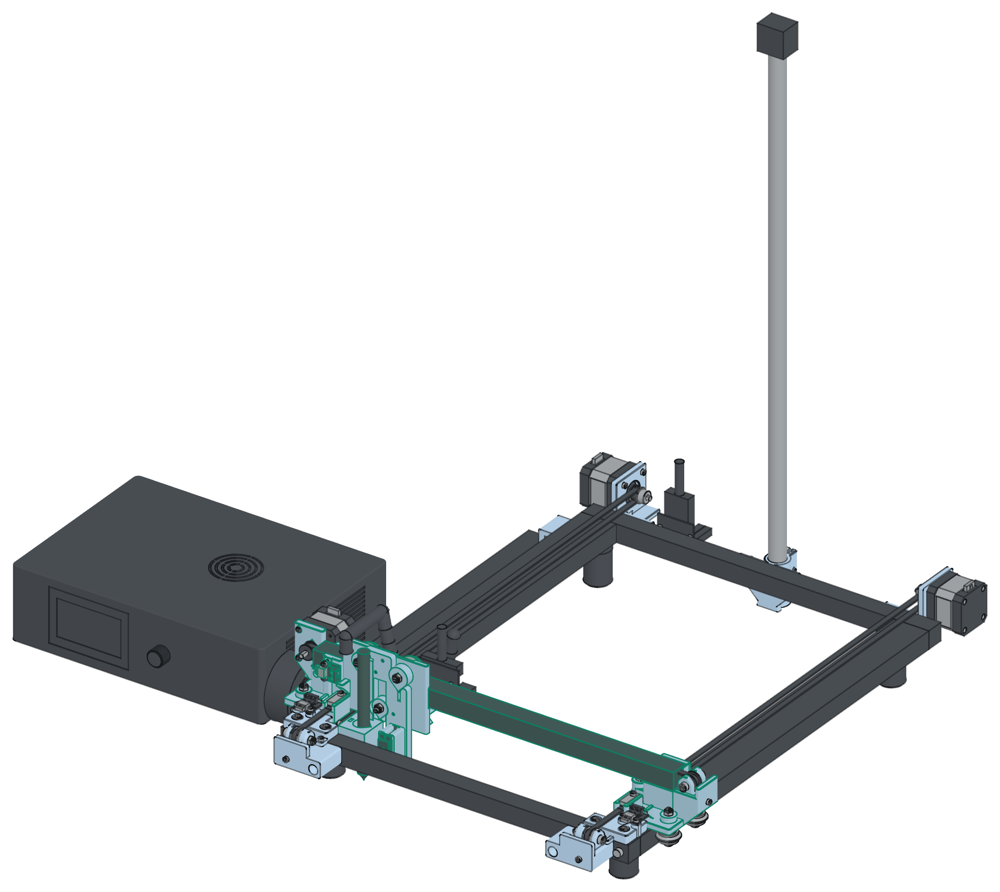

# CR-10 V3 table plotter: printed parts

<picture>
  <source media="(prefers-color-scheme: dark)" srcset="docs/hero-dark.png">
  
</picture>

The base frame of a CR-10 V3 stands on the table. The table is the bed. These parts turn the
frame into a pen plotter.

The main build keeps the stock CR-10 V3 electronics. The stock control box (Creality v2.5.2 board
with an ATmega2560, the LCD and the knob, the 350 W supply) stands on the table, left of the frame.
The stock harness stays. Its two breakout boards stand bare on two 4 mm nylon standoffs each, held by
cable ties. The firmware (`firmware/cmd/mega`) runs on the ATmega2560.

- **Y carriages (flat plates).** The build uses no stock plates. The printed plates keep the stock layouts, without the
  extra mounting points of the stock plates. Each Y carriage is a flat 6 mm printed plate,
  as the stock CR-10 Z carriage plate (in the Creality CR-10 STEP model it is an aluminium plate of 60 × 58.5 × 5.1 mm with
  R3 corners and three wheel holes in a triangle). It prints flat, the plate on the bed. It has only these features:
  - Three stock V-wheels on vertical axles in the side slots of the rail (2040, laid flat): 2 outside the rail, 44 mm
    apart (the back one on the eccentric spacer, in an 18 mm boss), 1 inside, 18 mm behind the beam centre, under a 12 mm
    boss on a tongue. The front outer axle goes up through the plate and a 6 mm boss, with an M5 nyloc nut on top. No part of the carriage goes under the rail.
  - Two clamp blocks for the upper run of the Y belt, with pockets open to the top. A printed belt jaw and an M3 screw
    into a heat-set insert in the ledge of each pocket clamp the belt end.
  - A saddle under the beam end. The beam lies on it. One M5 × 12 goes through a short back wall into a T-nut in the
    back slot of the beam. A stop at the outer end holds the beam along X. The inner face of the saddle is the hard stop
    of the X plate. A tunnel with a 45 degree roof hollows the saddle.
  - The Y endstop striker: a fin on the front edge of the plate.
  - Left only: the tab for the moving end of the drag chain; the X motor wall behind the beam end (the 42-34 motor face
    on its back, three M3 screws, a 45 degree underside past the plate edge); the X endstop wall in front of the beam end
    (the board faces the front on two standoffs with M3 heat-set inserts).
  - Right only: the seat and the end wall of the X idler fork past the beam end.
- **Y drive (fixed motors).** The Y motors are fixed. This keeps the X axis light. Each Y belt is a loop
  over its rail, flat, over the inner top slot (31.5 mm from the outer face of the side). The rail slot ends are closed
  by the 2020 bars, so the belt does not go in a slot. The lower run passes 1 mm over the rail top and the bar tops. The
  upper run is 12 mm higher: the carriage clamps it in two clamp blocks. The Y motors (42-40) stand behind the back bar
  on printed brackets (`y_motor_mount_*`, two M5 into T-nuts in the back face slot of the bar). A toothed 20T idler
  stands in a two-cheek fork (`y_idler_fork`) on the arm of the front base, in front of the front bar. An M3 screw from
  the front pulls the fork forward: that sets the belt tension. The screw is on the belt centre line, under the idler,
  so the fork does not turn in its seat. Its nut goes into a slot in the floor of the fork, from below. The fork is
  in a bracket (`y_idler_bracket_*`). An M3 × 12 screw goes down through the inner lip of the front base into the
  bracket. An ear beside the inner guide holds an M5 × 12 countersunk screw (ISO 10642) into a T-nut in the front face
  slot of the front bar. The ear prints on its front face, so the head seat is a 45 degree cone. The belt tension
  pushes the bracket back onto the bar face. The Y endstops sit on the front bases; the striker of
  each carriage pushes its lever. Homing squares the gantry.
- **Moving cables.** One openable drag chain (inner 10 × 20 mm, R28) lies beside the left rail, outside the frame. It
  holds only the head harness. Its lower run lies on the table, its fixed end sits in an anchor at the back left
  corner (`y_chain_anchor`), and its moving end bolts to the tab of the left carriage plate. The servo lead runs in a
  1/2 inch split wire loom: from the head board it hangs in a free slack loop behind the beam, goes over the beam and
  the X plate top, and goes down the front of the X plate to the servo. One cable tie at each end holds it: round the
  head harness cable over the head board, and through a slot at the top left of the X plate. The X motor plugs into
  the head board on the beam: its cable does not move.
- **X axis (the stock CR-10 belt path).** The X axis keeps the stock CR-10 V3 layout, with printed plates and a printed
  carriage. The X belt runs as on the stock CR-10 (read from the Creality CR-10
  STEP model): the pulley axis lies along Y on the beam centre line, past the left beam end, with the motor behind it.
  One run lies in the channel of the top slot of the beam, the other in the channel of the bottom slot. The X plate
  clamps the bottom run: at each end of the plate the belt leaves the bottom slot at 45 degrees into a clamp pocket
  under the beam. A toothed 20T idler turns in a two-cheek fork past the right beam end (`x_idler_fork`); an M3 screw
  from outside the right carriage pulls it outward, on the belt centre line under the idler. The X motor is a 42-34 (213.4 g, measured): it rides on the gantry.
- **X plate.** The printed X plate (`x_carriage_plate`) replaces the stock Creality plate. It keeps the 3 stock
  V-wheels and the 4 tool head holes. The eccentric is on the top right wheel. The plate prints upright. It has the two
  X belt clamps under the beam, the X endstop trigger lug at the bottom left (it reaches forward to the lever tip of the
  board on the X endstop wall), and the tie slot of the servo loom at the top left.
- **Pen carriage.** One part on the front of the X plate, held by the 4 M3 × 12 tool head screws from the back of the
  plate. A servo lifts the pen slider on a dovetail rail. The weight of the slider and the pen is the pen force.
- **Breakout boards.** The head board stands on the back face of the X beam (x = 96 mm), the base board on the
  back face of the back bar. Each stands on two 4 mm nylon standoffs; a cable tie goes through each board hole and
  standoff, round the extrusion. The big plug points up.
- **Camera pole foot (optional, `mast_foot`).** It holds a 590 mm camera pole (17.85 mm)
  behind the centre of the back bar. The foot hangs on the bar, 3 mm over the table. An M6 screw goes up through its
  floor into the pole end. A split collar with one M3 screw takes up the play. Two M5 screws in
  T-nuts hold it on the back bar.
- **Belt ends.** A printed belt jaw (`belt_jaw`, 6: 2 on each Y carriage, 2 on the X plate, 21.2 × 8.2 × 4 mm, flat
  on the bed) clamps each belt end. In each pocket the belt goes through the slit of the end wall, runs 10 mm along
  the pocket floor, and folds 180 degrees back over itself. A ledge starts 3 mm past the fold. The jaw lies on the two layers and, past the
  fold, over the ledge. One M3 × 10 screw goes through the jaw into an M3 heat-set insert in the ledge. The ledge top
  is 0.3 mm under the jaw: the screw presses the two layers 0.3 mm and stops when the jaw is on the ledge. The Y jaws go
  into the pockets from the top, the screw from the top. The X jaws slide into the 45 degree pockets from the back,
  under the two layers. Their screws go in from below through a 7 mm hole under the jaw. Clamp one end, route the belt,
  pull the other end tight by hand, fold it, cut the tail and clamp it.
- **Three fit tests** (the dovetail rail, the slider, and the V-wheel holes).

**Design language.** All printed parts of the main build share one finish (`parts.finish`):

- Each outside corner that stands up in the print has a 2 mm radius (`EDGE_R`).
- Each outside edge of a top face in the print has a 0.6 mm chamfer (`EDGE_CH`).
- The finish removes material at outside edges only. Holes, pockets, slots and mating faces keep their shape.
- The pen carriage gets the radius only, because its top edges carry the slider rail.
- One accent colour (`ACCENT`, light blue #7FB6E0) marks all printed parts in the sim, the images and the parts list.
  The extrusions are dark metal. Bought parts are grey or black.

**Feet.** The model has four rubber feet under the long rails (ESTIMATE: 28 mm across, 37 mm
high, centres 31 mm in from each side and 37.5 mm from each end). The fit check sweeps each foot over the
full Y travel. No moving part touches a foot. The feet also stay clear of the Y drag chain and the chain
anchor arm. `MEASURE.md` items 1 to 3 ask for the real sizes.

The main build (stock controller, no fit tests) has 22 printed parts in 16 print jobs: 23 h 08 min with 406 g of PLA ($8.12). Before the simplification of 2026-11-10 it was 27 parts, 30 h 28 min, 544 g ($10.88). The fit tests add 49 min and 14 g.

### Notes

Twelve heat-set inserts, all M3: two in each front base
for the Y endstop boards, two on the X endstop wall of the left Y carriage, and two in the clamp ledges of each Y
carriage and of the X plate for the belt jaws. `REVIEW.md` records the review rounds,
the change back from MGN12 rails to the stock V-wheels, the change to vertical Y wheels, the printed X plate with the fixed
motors, and the simplification of 2026-11-10.

No part needs supports. PLA on a LulzBot TAZ Workhorse (0.5 mm nozzle, 2.85 mm filament, 0.3 mm
layers). `penplotter-build-guide.pdf` has the parts list, the print times, the print settings, and
the steps.

The pen travel is 245.9 × 395.1 mm in the model. At the front the carriage plate stops at the front base; at the back
the inner Y wheel stops at the back bar. Set the firmware to 245 × 390 mm (home is unchanged).

### Fasteners

The model has each screw, nut, washer, spacer and T-nut of the main build (`fasteners.py`). The fit
check moves them with the parts over the whole travel. No fastener touches a printed part, the
frame, a belt or another fastener, except where it is meant to: a T-nut in a slot, a screw in a
motor thread. `model.py` also checks each screw length: the thread in the T-nut, the motor or the
pilot hole, and the end past each nut. Each wheel axle has an M5 nyloc nut. No wheel axle goes into an insert. The
endstop screws and the belt jaw screws go into M3 heat-set inserts. The other M2, M3 and M5 screws in
plastic cut their own thread. The hardware has its real shape: ISO 4762 socket heads and ISO 7380
button heads with the hex socket, ISO 4032 nuts and ISO 7040 nyloc nuts with their chamfers and the
nylon ring collar, washers, roll-in T-nuts, spacers, the eccentric spacer with its offset hex, and
the knurled inserts. The simulator gets a coarser mesh of the small hardware. `stl/sim2/fasteners_*.stl` has the fasteners for the simulator, one
file for each group that moves. `stl/sim2/inserts_gantry.stl` has the brass inserts.

| Part | Fasteners |
|---|---|
| Frame (stock screws) | 8 × M5 x 30 socket head (stock) |
| Y front base, left | 2 × M3 heat-set insert, 5.7 mm, 2 × M3 x 8 socket head, 2 × M5 drop-in T-nut, 2 × M5 x 12 socket head |
| Y motor bracket, left | 4 × M3 x 10 socket head, 2 × M5 drop-in T-nut, 2 × M5 x 12 socket head |
| Y idler fork, left | 1 × M3 nut, 1 × M5 nyloc nut, 2 × M5 washer, 7.5 mm across (small), 1 × M5 x 30 socket head |
| Y idler bracket, left | 1 × M3 x 12 socket head, 1 × M3 x 20 socket head, 1 × M5 drop-in T-nut, 1 × M5 x 12 countersunk (ISO 10642) |
| Y front base, right | 2 × M3 heat-set insert, 5.7 mm, 2 × M3 x 8 socket head, 2 × M5 drop-in T-nut, 2 × M5 x 12 socket head |
| Y motor bracket, right | 4 × M3 x 10 socket head, 2 × M5 drop-in T-nut, 2 × M5 x 12 socket head |
| Y idler fork, right | 1 × M3 nut, 1 × M5 nyloc nut, 2 × M5 washer, 7.5 mm across (small), 1 × M5 x 30 socket head |
| Y idler bracket, right | 1 × M3 x 12 socket head, 1 × M3 x 20 socket head, 1 × M5 drop-in T-nut, 1 × M5 x 12 countersunk (ISO 10642) |
| Y chain anchor | 2 × M3 x 10 socket head, 1 × M5 drop-in T-nut, 1 × M5 x 12 socket head |
| Camera pole foot (optional) | 1 × M3 nut, 1 × M3 x 16 socket head, 2 × M5 drop-in T-nut, 2 × M5 x 12 socket head, 1 × M6 x 16 socket head |
| Y carriage, left (X motor) | 2 × belt jaw (printed), 4 × M3 heat-set insert, 5.7 mm, 7 × M3 x 10 socket head, 2 × M3 x 8 socket head, 1 × M5 drop-in T-nut, 3 × M5 nyloc nut, 2 × M5 spacer, 6 mm (stock), 1 × M5 x 12 socket head, 3 × M5 x 35 socket head, 1 × eccentric spacer (stock) |
| Y carriage, right (X idler) | 2 × belt jaw (printed), 2 × M3 heat-set insert, 5.7 mm, 2 × M3 x 10 socket head, 1 × M3 x 20 socket head, 1 × M5 drop-in T-nut, 3 × M5 nyloc nut, 2 × M5 spacer, 6 mm (stock), 1 × M5 x 12 socket head, 3 × M5 x 35 socket head, 1 × eccentric spacer (stock) |
| X idler fork | 1 × M3 nut, 1 × M5 nyloc nut, 2 × M5 washer, 7.5 mm across (small), 1 × M5 x 30 socket head |
| X plate | 2 × belt jaw (printed), 2 × M3 heat-set insert, 5.7 mm, 2 × M3 x 10 socket head, 4 × M3 x 12 socket head, 3 × M5 nyloc nut, 2 × M5 spacer, 6 mm (stock), 1 × M5 x 30 button head (ISO 7380), 2 × M5 x 35 button head (ISO 7380), 1 × eccentric spacer (stock) |
| Pen carriage | 2 × M2 x 8 self-tapping (stock, in the servo bag) |
| Pen slider | 1 × M3 nut, 1 × M3 x 20 socket head |

Totals in the model (to buy):

- 12 × M3 heat-set insert, 5.7 mm
- 5 × M3 nut
- 21 × M3 × 10 socket head
- 6 × M3 × 12 socket head
- 1 × M3 × 16 socket head
- 4 × M3 × 20 socket head
- 6 × M3 × 8 socket head
- 15 × M5 drop-in T-nut
- 12 × M5 nyloc nut
- 6 × M5 washer, 7.5 mm across (small)
- 13 × M5 × 12 socket head
- 2 × M5 × 12 countersunk (ISO 10642)
- 1 × M5 × 30 button head (ISO 7380)
- 3 × M5 × 30 socket head
- 2 × M5 × 35 button head (ISO 7380)
- 6 × M5 × 35 socket head
- 1 × M6 × 16 socket head

Stock parts in the model: 2 × M2 × 8 self-tapping (stock, in the servo bag), 6 × M5 spacer, 6 mm (stock), 8 × M5 × 30 socket head (stock), 3 × eccentric spacer (stock). Buy 2 more T-nuts as spares. Print the 6 belt jaws.

## Status

The frame sizes and the camera pole are measured. The servo sizes and the wheel sizes are data sheet values or estimates. These
values are **estimates**: the feet and the height of the cross bars above the table (`FOOT_H`), the slots
and the T-nuts, the bar screw heads (from photos), the two
breakout boards (size, holes, plugs), the size of the control box, and the thread depth in the pole. Print the fit tests first. `MEASURE.md` lists the
measurements to take. Measure the feet first: the back feet set the Y travel.

## Files

| File | Content |
|---|---|
| `shape.py` | All dimensions. `ESTIMATE` marks the values that are not measured. |
| `fasteners.py` | The screws, nuts, washers, spacers and T-nuts of the main build, and the screw length check. |
| `parts.py` | The parts and the context (frame, wheels, the 2020 slot profile, motors, pulleys, idlers, servo, pen), in build123d. |
| `model.py` | The fit check, the travel limits, then `cad/*.step`, `stl/*.stl` (print orientation), the meshes for the images, and `stl/frame.json`. |
| `stl/` | The printed parts in print orientation. |
| `stl/sim2/`, `stl/frame.json` | The parts and the frame geometry for the 3D window of the simulator. |
| `cad/` | A STEP file for each part, `table-plotter-assembly.step` (the breakout boards and the control box), and `pen-lift-assembly.step`. |
| `cura/make_profiles.py` | A Cura profile for each part, the filament use, and the support check. |
| `lineart/render.mjs` | The line-art images. |
| `make_pdf.py` | The build guide PDF. |
| `make.sh` | Runs all steps. It stops if the fit check, the mesh check, or the support check fails. |
| `stats.py` | Prints the print time, the filament and the cost of each part, from the slices, with the totals of the main build. |
| `REVIEW.md` | The review rounds: findings, decisions, and numbers. |

## Build

```sh
./make.sh
```

It needs `uv`, Node.js, Chromium, ImageMagick, and CuraEngine in `/opt/ultimaker-cura`.

### Slicer profiles

`cura/make_profiles.py` writes the Cura profiles for a LulzBot TAZ Workhorse SE (0.5 mm nozzle,
2.85 mm filament). It needs a local Cura definition of this printer in
`~/.local/share/cura-workhorse-profile` (`lulzbot_taz_workhorse_se.def.json`) for the slice and the
support check. It writes the profiles to `cura/profiles/`. `--install` copies them to
`~/.local/share/cura/5.13/quality_changes`. A standard Cura installation does not have the definition folder.

The portable route is `printdeck.yml` and `profiles/` at the repository root. `printdeck.yml` lists
each printed part with its file, its profile and its settings. `profiles/` holds the slicer profiles.

### Endstops

The endstops are the stock Creality endstop boards (20 × 20 mm, two M3 holes 15 mm apart, a KW12
switch with a long lever, an XH plug that enters along the board). Each board stands on two 4 mm
standoffs: the pins under the board need the room.

- Y1 and Y2: flat on the front bases, the plug to the front. Two M3 × 8 screws go into M3 heat-set
  inserts. A striker fin on the front edge of each carriage plate meets the lever tip past the
  corner of the board, so the board is never in its path.
- X: on the front of the X endstop wall of the left Y carriage (in front of the beam end), the parts to the front. Two
  M3 × 8 screws go into M3 heat-set inserts in the two standoffs. The trigger lug at the bottom left of the X plate reaches
  forward to the lever tip; next to the plate face the lug is 1 mm narrower, so it passes the edge of the board.
- The fit check: at the hard stop each trigger is 1.0 to 2.0 mm past the click, in line with the
  click point, and clear of the board. Each plug zone (20 mm past the plug edge) is clear over the
  full travel. The lever and click values are ESTIMATES (`ES` in `shape.py`, `MEASURE.md` item 52).

## Design goals

These goals apply to the whole project. Each change is scored against them in `REVIEW.md`.

1. High quality: a stiff pen tip, no backlash, repeatable homing; the joint audit passes; no part
   creeps under preload; one fit and finish.
2. Few visible parts: hidden fasteners and wires, the X belt in the beam slot, flush parting lines.
3. Easy maintenance: each adjustment reachable without taking parts off, wear parts replaceable on
   their own, standard screws and few hex key sizes, plugs at the moving parts, marks where they help.
4. Quiet operation: rubber feet, no rattling parts, correct belt tension, smooth wheel preload.
